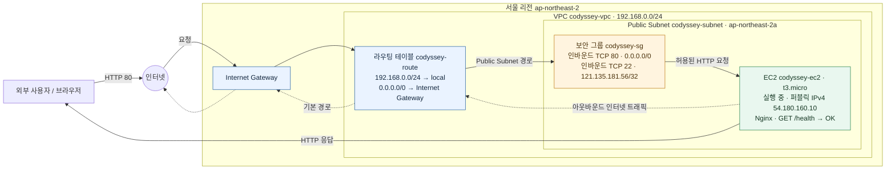

# AWS VPC + EC2 웹 서버 아키텍처

서울 리전(`ap-northeast-2`)에서 캡처로 확인한 실습 구성을 Mermaid로 나타냈습니다. CIDR, 리소스 이름, 인스턴스 상태와 공개 IPv4 주소는 `screenshots/`의 AWS 콘솔 캡처를 기준으로 기록했습니다.

## 캡처에서 확인한 구성

- VPC `codyssey-vpc`와 라우팅 테이블의 로컬 경로에서 CIDR `192.168.0.0/24`를 확인했습니다.
- `codyssey-route`는 `codyssey-subnet`에 연결되어 있고, 기본 경로 `0.0.0.0/0`의 대상으로 Internet Gateway가 표시됩니다.
- EC2 캡처에서 `codyssey-ec2`는 `ap-northeast-2a`의 `t3.micro`, 실행 중이며 퍼블릭 IPv4 주소는 `54.180.160.10`입니다.
- `codyssey-sg` 인바운드는 HTTP TCP/80 전체 공개와 SSH TCP/22 `121.135.181.56/32` 제한으로 캡처되어 있습니다.
- 브라우저 캡처에서 `http://54.180.160.10/health` 응답 본문 `OK`와 기본 Nginx 페이지를 확인할 수 있습니다.
- 다이어그램은 캡처에서 확인된 단일 서브넷·단일 EC2 구성을 표현합니다. IAM 정책의 실제 권한 범위는 IAM 캡처에서 확인되지 않아 네트워크 흐름 그림에는 포함하지 않았습니다.

## 증빙 이미지

- [EC2 인스턴스](../screenshots/EC2_Instances.png)
- [보안 그룹 규칙](../screenshots/EC2_SecurityGroup.png)
- [라우팅 테이블 목록](../screenshots/VPC_RouteTables.png)
- [라우팅 테이블 경로 및 서브넷 연결](../screenshots/VPC_RouteTable.png)
- [Nginx 외부 상태 확인](../screenshots/Nginx_healthcheck.png)
- [Nginx 기본 페이지](../screenshots/Nginx_running.png)
