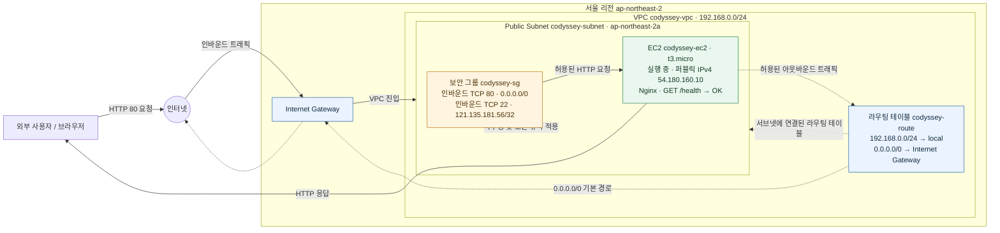

# AWS VPC + EC2 웹 서버 아키텍처

서울 리전(`ap-northeast-2`)에서 캡처로 확인한 실습 구성을 Mermaid로 나타냈습니다. CIDR, 리소스 이름, 인스턴스 상태와 공개 IPv4 주소는 `screenshots/`의 AWS 콘솔 캡처를 기준으로 기록했습니다.

## 아키텍처 다이어그램

## 캡처에서 확인한 구성

- VPC `codyssey-vpc`와 라우팅 테이블의 로컬 경로에서 CIDR `192.168.0.0/24`를 확인했습니다.
- `codyssey-route`는 `codyssey-subnet`에 연결되어 있고, 기본 경로 `0.0.0.0/0`의 대상으로 Internet Gateway가 표시됩니다.
- EC2 캡처에서 `codyssey-ec2`는 `ap-northeast-2a`의 `t3.micro`, 실행 중이며 퍼블릭 IPv4 주소는 `54.180.160.10`입니다.
- `codyssey-sg` 인바운드는 HTTP TCP/80 전체 공개와 SSH TCP/22 `121.135.181.56/32` 제한으로 캡처되어 있습니다.
- 브라우저 캡처에서 `http://54.180.160.10/health` 응답 본문 `OK`와 기본 Nginx 페이지를 확인할 수 있습니다.
- 다이어그램은 캡처에서 확인된 단일 서브넷·단일 EC2 구성을 표현합니다. IAM 정책의 실제 권한 범위는 IAM 캡처에서 확인되지 않아 네트워크 흐름 그림에는 포함하지 않았습니다.

## 네트워크 트래픽 흐름

### 1. 인바운드 트래픽

외부 사용자가 EC2 웹 서버에 접속할 때의 흐름입니다.

1. 외부 사용자가 퍼블릭 IPv4 주소를 통해 HTTP 요청을 전송합니다.
2. Internet Gateway가 인터넷과 VPC 사이의 통신 경로를 제공합니다.
3. Public Subnet에 연결된 Route Table을 기준으로 트래픽의 경로가 결정됩니다.
4. EC2에 연결된 Security Group이 인바운드 규칙에 따라 접근을 허용하거나 차단합니다.
5. HTTP 80번 포트로 허용된 요청이 EC2에 도달하고 Nginx가 응답합니다.

현재 보안 그룹은 HTTP TCP/80을 모든 IPv4 주소에서 허용하고, SSH TCP/22는 `121.135.181.56/32`에서만 허용하도록 구성되어 있습니다.

### 2. 아웃바운드 트래픽

EC2에서 외부 인터넷으로 요청을 전송할 때의 흐름입니다.

1. EC2에서 외부 서버로 요청을 전송합니다.
2. Security Group의 아웃바운드 규칙에 따라 트래픽 허용 여부가 결정됩니다.
3. Public Subnet에 연결된 Route Table에서 목적지에 맞는 경로를 확인합니다.
4. 외